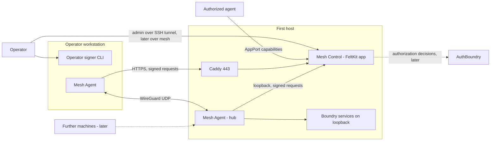
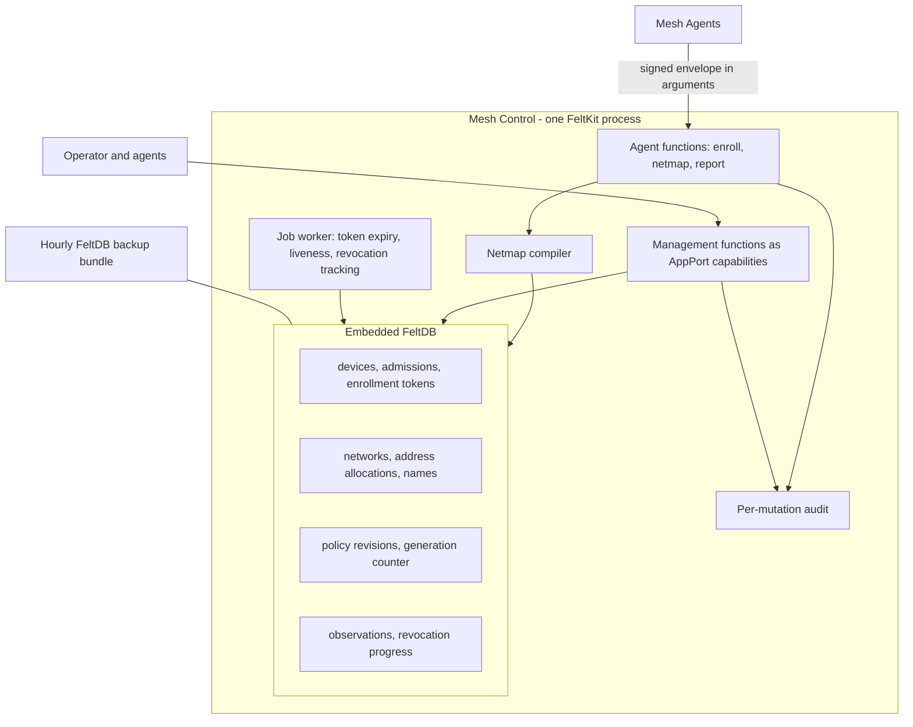
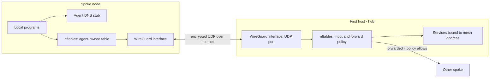
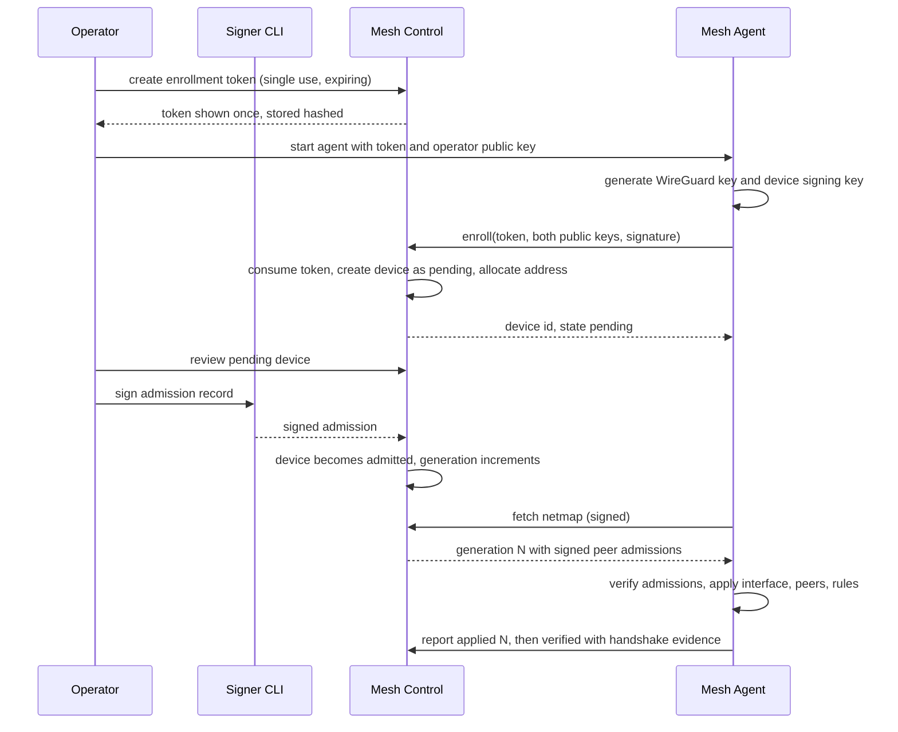
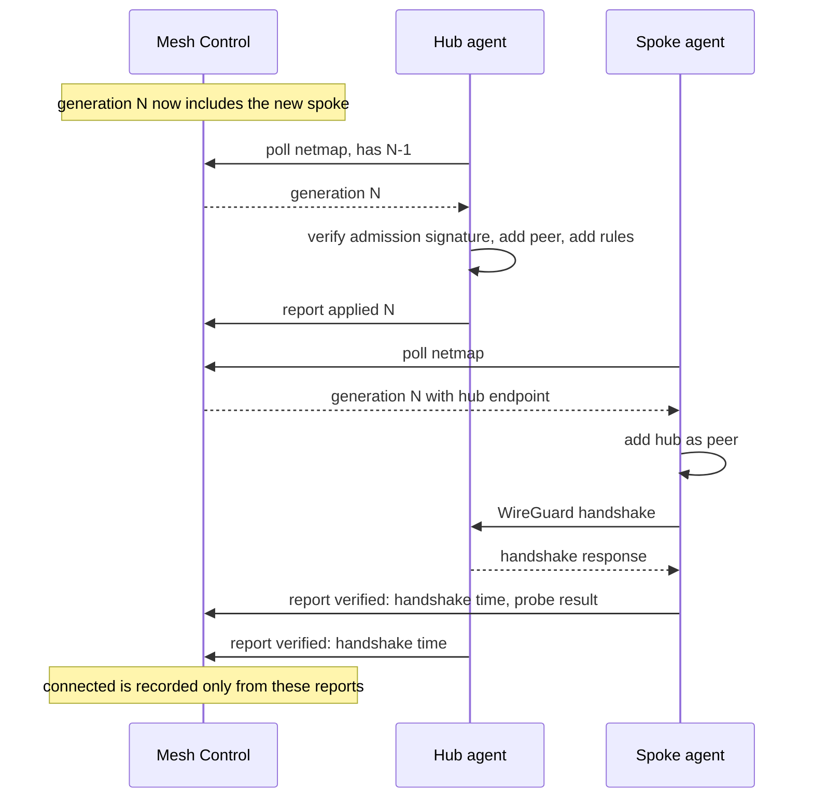
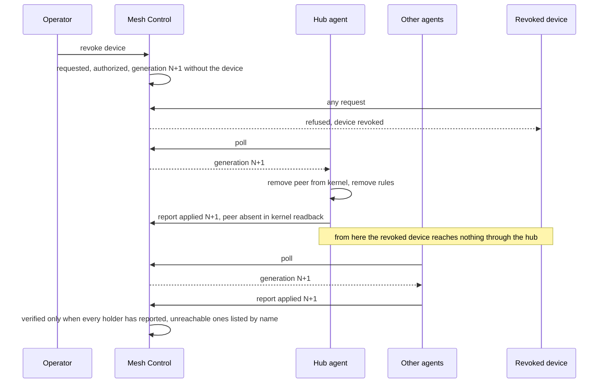

# Boundry Mesh — Architecture Assessment and Proposed Roadmap

Status: **architecture approved with feasibility gates (2026-11-17).** Nothing in this document has been built, and no host was contacted.
Date: 2026-11-17.

This is the public, redacted edition. Host-specific details (addresses, firewall rules, listening ports, workload inventory, backup posture) and any unverified security findings are held privately and are referred to here as "the private host baseline".

## 0. How to read the evidence

Every claim about the existing platform carries one of these levels.

| Level | Meaning |
|---|---|
| **RUN** | Tests were executed in this session and the result observed. |
| **READ** | Code and tests were read; tests were not executed (dependencies not installed or not vendored). |
| **RECORDED** | A fact recorded in a repository file about the host (for example a preflight JSON), with its date. Not re-observed. |
| **INFER** | Reasoned from other facts. |
| **UNKNOWN** | Cannot be established from the repositories. |

What was actually executed:

| Repo | Result |
|---|---|
| feltkit | `node --test`: 709 pass, 25 fail, 10 skipped. The sampled failures name ambient `FELTDB_URL`-style variables present in this sandbox; six of the failing files re-ran clean (44 pass, 0 fail) with them unset. Four failing files were not re-run. |
| feltdb_intent | `cargo test`: 4 pass, 0 fail. |
| appport | Two Python example suites: 22 pass. The main vitest suite was not run. |
| flow_db, authboundry, appboundry, appport-services, resolver, resolver-control | **Not run.** Everything said about them is READ. |

Repositories inspected (HEAD): feltkit `c9fae9d`, flow_db `a55a5a6`, appport `a6c2c61`, appboundry `9f84020`, authboundry `50e6ad4`, appport-services `30f376a`, resolver `aaab053`, resolver-control `d41ef9e`, boundry `77cc2be`, boundry-ci `1070bd3`, boundry-maint `5bc45cb`, boundry-intel `3791e7c`, felt-ops `d4d62b6`, feltdb_intent `954d532`. `boundry-mesh` itself is empty.

---

## 1. The answer to the central question

**Can FeltKit make the control plane dramatically smaller while the networking stays robust and independently verifiable? Yes for the control plane, with three specific gaps. It contributes nothing to the networking, which is where most of the work and risk sit.**

FeltKit is a Node server runtime, not only a client framework. An application declares collections and typed server-side `query` / `mutation` / `action` functions, and FeltKit runs them in one process over an embedded FeltDB. That means the mesh control plane does not need to be a new service. It can be **one FeltKit application**:

| Control-plane need | FeltKit provides | Level |
|---|---|---|
| Durable records with unique and reference constraints | `app.collection(..., { unique })`, enforced by FeltDB at commit | RUN |
| Atomic, validated, server-authoritative writes | mutations commit as one transaction; uniqueness races tested ("exactly one commits") | RUN |
| Unique IP and device-key allocation | unique constraint plus conflict retry; gapless sequences | RUN |
| A network-wide version number | gapless sequence incremented in the same transaction | RUN |
| Per-mutation audit, atomic with the write | `_feltkit_audit`, append-only, unreachable by app code | RUN |
| Background control loops (token expiry, liveness) | in-process job worker with leases and retries, 1 s tick | RUN |
| Operator roles and resource policies | role permissions, deny-override policies, tenant scoping | RUN |
| Custom caller authentication | `auth.authenticate` hook (headers only — see gap) | RUN for the hook; READ for its limits |
| Management API as AppPort capabilities, with MCP for agents | each function can declare `capability`, served at `/appport` | READ |
| Human approval for agent-proposed operations | `approval: "required"` on a function | READ |
| Admin UI | Studio dashboard | READ |
| Single-host deployment | `deploy --target container`: one container, embedded FeltDB on a volume | READ; never verified on a real host by FeltKit's own audit |

What FeltKit does **not** provide, and what that forces:

1. **No data-carrying, resumable change stream.** `GET /api/events` sends invalidations only, with no cursor. *Consequence:* the node agent must not depend on push for correctness. It polls a versioned snapshot and uses events, if at all, only as a hint to poll sooner. This is the same shape AppBoundry's own host agent already uses (5 s outbound poll).
2. **The authentication hook sees method, path and headers, never the body** (`packages/sdk/src/server/index.ts:233-236`). *Consequence:* a device's proof-of-possession signature cannot be bound to the request body in the hook. The signed envelope must travel inside the function arguments and be verified in the handler, or FeltKit gains a body-digest check.
3. **No device concept anywhere** — not in FeltKit, FeltDB, AppPort or AuthBoundry. API keys in FeltKit all share one role set. *Consequence:* device identity is mesh application code.

By the FeltKit investigator's count, FeltKit covers roughly **35–45% of the control plane's functional needs as shipped**. The more useful statement is what the remainder turns into: mesh-specific logic written as application code on FeltKit (schema, about twenty functions, a netmap compiler, a device-signature verifier), not a server, database layer, API layer, authorization engine, audit system and admin UI built from nothing. A working hypothesis, not a commitment: 2–3k lines of TypeScript for the control plane against 5–8k lines of Rust for the node agent. Actual effort is to be measured per milestone (section 7.2).

So the honest picture is: **the control plane becomes small; the node agent is the product.**

---

## 2. Architecture assessment

### 2.1 Proposed system

Four parts, with one direction of authority.

| Part | What it is | Where it runs | Owns |
|---|---|---|---|
| **Mesh Control** | One FeltKit application, embedded FeltDB | One container on the first host, loopback-bound, behind the existing reverse proxy | Intended state, lifecycle, evidence |
| **Mesh Agent** | One native binary (Rust) | Every member machine, as a systemd or launchd service | Applying and verifying network state locally |
| **Data plane** | WireGuard (kernel on Linux, userspace on macOS) plus nftables | Every member machine | Packets |
| **Operator signer** | A CLI holding an Ed25519 key | The operator's workstation, never the host | Admission of new peers |

Verdict on the architecture you proposed in section 3 of the assignment:

| Proposed | Verdict | Change |
|---|---|---|
| A. Control plane on FeltKit and FeltDB, exposed through AppPort | **Keep.** | It is a FeltKit app, not a new service. Its FeltDB is embedded and separate from every FeltDB instance the mesh protects. |
| B. Lightweight native node agent | **Keep.** | Model it on AppBoundry's existing host agent: outbound-only poll, reconcile, report. |
| C. Data plane with NAT traversal, STUN, DERP-like relay | **Keep WireGuard; defer the rest.** | Start hub-and-spoke through the first host, which has a public address. No STUN, ICE or relay code until a real pair of nodes needs it. |
| D. DNS through Resolver | **Reject Resolver for DNS.** | Resolver is a configuration and alias store with no DNS protocol. Mesh Control owns names; each agent answers DNS locally. Resolver may later hold service aliases. |
| E. AppBoundry apps declare network requirements | **Keep as a later track.** | Seven concrete gaps stand between today's AppBoundry and this (section 3.4). It is not MVP. |

### 2.2 Control plane and data plane separation

- The agent keeps its last applied configuration on disk and in the kernel. **If Mesh Control is down, existing tunnels keep working.** New enrollments, policy changes and revocations wait.
- Mesh Control never touches a network interface. It only records intent and receives reports.
- The agent never decides policy. It applies a compiled configuration and reports what it observed.

One limit must be stated plainly: in the first topology the hub and Mesh Control are the same machine. If the first host is down, the mesh is down. That is a consequence of having one always-on machine, not of the design.

### 2.3 Intended, applied, observed, verified

Every piece of network state has four distinct records. A later one is never inferred from an earlier one.

| State | Written by | Means |
|---|---|---|
| **Intended** | Mesh Control mutation | A human or authorized caller asked for it and it was accepted. |
| **Distributed** | Mesh Control, when an agent fetches generation N | That agent has been handed the configuration. |
| **Applied** | Agent report, signed | The agent read back kernel state and it matches generation N. |
| **Verified** | Agent report, signed | An independent observation: a recent WireGuard handshake, a probe that succeeded, or a probe that was correctly refused. |

### 2.4 Identity model

- Each device generates **two** keypairs locally: a WireGuard key for packets and an Ed25519 key for signing control-plane requests. Neither private key ever leaves the machine.
- Enrollment uses a single-use, expiring token created by an operator and stored hashed.
- Every agent request is signed with the device key, with a timestamp and a per-device counter for replay protection.
- **Adding a peer requires a human signature; removing one does not.** A device is admitted only when the operator signs its admission record (device id, both public keys, mesh address) with a key held off the host. Agents pin the operator public key at enrollment and refuse to add any peer whose admission signature does not verify. Removal is fail-safe, so Mesh Control may remove peers on its own.

That asymmetric rule is what limits a compromised control plane: it can cut devices off, but it cannot introduce one. The scheme copies the Ed25519 change-authorization pattern already implemented in Resolver (READ).

### 2.5 Topology and addressing

- **Hub-and-spoke.** Every node peers with the first host. The host forwards between spokes and enforces policy on forwarded traffic.
- **Addressing.** Provisional: one private IPv4 `/24` for devices and one reserved, plus a randomly generated private IPv6 `/48`. The candidate ranges are in the private host baseline and are not fixed until they have been re-checked against live routes, container networks and VPN routes on the host and on each developer machine. `100.64.0.0/10` is excluded by policy: it collides with Tailscale and carrier NAT, and AppPort Services' webhook policy blocks it.
- **Names.** `mesh.boundry.company` is reserved as the private namespace. It is answered privately only: no device or service record is published in public DNS.

### 2.6 Policy and enforcement

- Default deny. A rule names a source (device or group), a destination device, a protocol and ports.
- WireGuard's allowed-IPs setting is only a per-peer source filter. Port-level rules are enforced with **nftables** in a table the agent owns outright. It never edits Docker's or ufw's rules.
- Rules are enforced twice: at the hub on forwarded traffic and at the destination node.

### 2.7 Revocation

States: `requested → authorized → distributed → applied → verified`.

- **Applied** means the hub (and any direct peer) reports that the revoked key is gone from the kernel. Kernel peer removal is immediate: allowed IPs and session keys are dropped with no drain.
- **Verified** means every node that held the key has reported its removal, with unreachable nodes listed by name and never counted as done.
- **Expected latency:** one poll interval (5 s proposed) plus apply time, for reachable nodes. This is a target to be measured in milestone 4, not a result.
- **Partition limit.** In hub-and-spoke, a revoked device can only reach others through the hub, and the hub sits beside Mesh Control. So revocation is effective as soon as the hub applies it. The harder case — a partitioned node that still accepts a revoked peer directly — only arises once direct peer-to-peer links exist. The decision between a configuration lifetime and outage survival can wait until then, and should be made explicitly at that point.

---

## 3. Existing capability inventory

Classes: **1** implemented and verified, **2** implemented but insufficiently tested, **3** partially implemented, **4** missing, **5** requires external infrastructure. Because most suites could not be run here, class 1 outside FeltKit means "code and meaningful tests exist", at READ level.

### 3.1 By investigation area

| Area | Best existing capability | Class | Reuse decision |
|---|---|---|---|
| Durable device and identity records | FeltKit collections with unique constraints. No device type exists anywhere; AuthBoundry's `Device` type is unused. | 1 for records, 4 for devices | Reuse FeltKit; model devices in the mesh app. |
| Authentication | FeltKit sessions and API keys; AuthBoundry GitHub, Google, password and email-code login. No JWT, signing keys or proof-of-possession in AuthBoundry. | 1 for humans, 4 for devices | Humans: existing login. Devices: mesh code. |
| Authorization | FeltKit roles and policies; AuthBoundry online decision endpoint with a policy engine and delegation. | 1 | Reuse both. AuthBoundry integration in FeltKit is tested mainly against a fake. |
| Resource-level access control | FeltKit resource policies and owner declarations; FeltDB record policies with four subject kinds. | 1 FeltKit, 3 FeltDB | Reuse FeltKit's. |
| Event delivery and sync | FeltKit invalidation-only server-sent events, no resume. FeltDB events with resume but no values or filters. AppPort events at-most-once. | 3 | Do not use for correctness. Versioned poll. |
| Agent execution and lifecycle | AppBoundry host agent: systemd, outbound poll, desired-versus-observed reconcile, reports. FeltKit's remote execution environments are unbuilt. | 2 | Reuse the pattern, not the code (it is TypeScript and Docker-specific). |
| Configuration distribution | None for native daemons. | 4 | Build: versioned netmap fetch. |
| Secret and key management | FeltKit credential vault (AES-256-GCM file); FeltDB envelope encryption for connection secrets; host env files, root 0600. No key generation, rotation or KMS. | 3 | Not needed for device keys, which stay on the device. Reuse host env-file convention for the control container. |
| Service discovery | None. AppPort registry is in-process and memory-only. Resolver maps names to configuration, not addresses. | 4 | Build in the mesh app. |
| Health and observability | Container healthchecks and `/health` endpoints. Host-level metrics and alerting are unverified. | 3 | Build agent reports; host-level monitoring is tracked separately. |
| AppBoundry isolation | WebAssembly sandbox with zero imports; hardened containers. No network isolation: one shared bridge, no rules, no tests. | 1 sandbox, 4 network | Later track. |
| Deployment and provisioning | Manual and operator-driven. Compose project and systemd units designed; whether they are installed is disputed between documents. | 2 | Follow the existing convention; verify state first. |

### 3.2 Per component

**FeltKit** — a Node runtime, CLI, dashboard and JS client on `@feltdb/core` and `@appport/*`. Single process with an exclusive lock, so no high availability. The HTTP function API is undocumented, but every function can also be served over AppPort's documented wire. Its own reality audit (2026-11-07) states that nothing is verified against a real hosting platform.

**FeltDB** — an in-memory store over an append-only log behind one lock, with a single-binary HTTP server and a real Rust client. Unique indexes, transactions and compare-and-set are solid. Limits that matter: history is held in memory without bound; each event subscriber triggers a linear scan every 250 ms; power-loss durability is explicitly "not established"; the per-request audit log is unchained and a lost event does not fail the request; a cron scheduler exists but the server never runs it. Deploy targets in the repo are Fly.io only.

**AppPort** — a protocol specification plus an embeddable TypeScript library. Capabilities are discovered without authentication and authorized at dispatch. The wire is language-neutral JSON, proven by an independent client test. It authenticates nobody; the host must. Core stores are memory-only. Parts of the advertised conformance kit do not exist.

**AppPort Services** — durable effect evidence in FeltDB including denials, and API keys with hashing, rotation and revocation but identity-only (no scopes). Its AuthBoundry client is an interface with no shipped implementation. Its webhook policy blocks private ranges and `100.64.0.0/10`, so webhooks to mesh addresses are blocked by default.

**AuthBoundry** — an online authorization-decision server with opaque bearer credentials. Reusable: operator login, tenants, policy decisions, durable decision audit, next-request revocation. Missing: device records, proof-of-possession, enrollment tokens, offline-verifiable tokens, tamper-evident audit, a non-JS client. Agent credentials expire in at most 30 days and then need a human, which rules them out as a durable machine identity.

**AppBoundry** — deploys WebAssembly apps in one hardened container each. See 3.4.

**Resolver** — a revisioned configuration and alias store (`ref://…` to value, secret, model, endpoint or agent). Not a naming system for networks. Its change-authorization scheme is the model for operator-signed admissions.

**Intent** — the live one is in `flow_db` and turns natural-language requests into FeltDB change proposals. `feltdb_intent` is a stale one-commit scaffold. Neither models desired versus observed network state. Not used.

### 3.3 The first deployment host

The specifics are in the private host baseline. What the architecture depends on:

| Fact | Level |
|---|---|
| One bare-metal host, shared with other workloads | RECORDED |
| Recent Ubuntu LTS with a kernel new enough for in-tree WireGuard | RECORDED for the kernel version; INFER for the module |
| A public IPv4 address and an IPv6 prefix, with no NAT in front | RECORDED |
| Ample spare CPU, memory and disk | RECORDED |
| Host-level reverse proxy terminating TLS | RECORDED |
| A host firewall is active and currently admits no UDP | RECORDED |
| Deployment is manual and operator-driven; no CI job reaches the host | RECORDED |

Capacity is not a constraint. **No additional server is justified for the MVP.**

The recorded facts come from a read-only preflight and an inspection in early November 2026; they are not current observations. Still UNKNOWN, each settled by one read-only command (milestone 0): the WireGuard module and tools, UDP listeners, IPv6 addressing and routes, forwarding settings, raw packet-filter rules, the provider-side firewall, backup status, and which platform services are actually running. On the last point the repositories contain conflicting records.

Constraints the design must respect:

- Boundry containers drop every capability, so **WireGuard runs on the host**, not in a container.
- Restarting the container runtime would disrupt co-located workloads. The mesh must never require it.
- Every existing installer is written never to touch the firewall. Opening one UDP port is a deliberate, separately approved production change.
- Backup and monitoring of the host must be verified before any mesh state is placed on it.

**Who the mesh would connect.** Today the only confirmed always-on machine under Boundry's control is this host. Everything else is hosted platform services, hosted CI runners and one operator workstation. The first real mesh is therefore **the host plus the workstation**.

### 3.4 AppBoundry: gaps to "declared requirement → enforced policy"

1. No manifest field for network requirements; the only values are `none` and `egress`, and the parser rejects anything else.
2. The deployment intent carries no policy.
3. All app containers share one bridge, with no stable per-app address to key a rule on.
4. No enforcement backend: the egress-control flag is never set, and `egress` means unrestricted.
5. Installers are forbidden from touching the firewall, so enforcement needs a new privileged component.
6. The host agent never passes FeltDB connection settings to app containers, so there is no app-to-FeltDB network path to protect yet.
7. No network-isolation tests exist.

Enforcement would attach at the host network layer: a per-app Docker network or fixed address, plus nftables rules written by the mesh agent from a signed policy. The app code itself has no sockets, so the subjects are the runtime and companion containers.

---

## 4. Architecture diagrams

### 4.1 System context



### 4.2 Control plane



### 4.3 Data plane



### 4.4 Device enrollment



### 4.5 Peer connection



### 4.6 Device revocation



---

## 5. Technology decisions

### 5.1 Decisions

| Layer | Decision | Status | Why | Licence |
|---|---|---|---|---|
| Linux data plane | In-kernel WireGuard, configured over netlink | Locked | Proven; no linking, so the kernel licence does not reach our code | GPL-2.0 (kernel) |
| macOS data plane | `wireguard-go` | Provisional | The proven userspace implementation | MIT |
| Agent language | Rust | Provisional | FeltDB and AuthBoundry are already Rust; permissive crates exist for every layer | — |
| WireGuard management | `defguard_wireguard_rs`, behind our own interface | Provisional, pending spike | Kernel and userspace support; actively released (0.12.5, 2026-11-04) | Apache-2.0 |
| Packet policy | nftables, agent-owned table | Locked | Port-level per-peer rules; independent of Docker and ufw chains | GPL-2.0 (tool, invoked) |
| Private DNS | `hickory-server` embedded in the agent | Provisional | Answers from the local netmap, so names resolve during a control-plane outage | MIT or Apache-2.0 |
| Control plane | FeltKit application, embedded FeltDB | Locked, subject to milestone 0 | Section 1 | Boundry-owned |
| Agent protocol | AppPort request wire with a signed envelope in the arguments | Provisional | AppPort's wire is documented and language-neutral; FeltKit's own function API is not | Boundry-owned |
| Signatures | Ed25519 through platform libraries (Node `crypto`, `ed25519-dalek`) | Locked | No cryptography of our own | permissive |
| NAT traversal and relay | None in the MVP | Locked | The hub has a public address | — |

Open points on these decisions:

- Which userspace implementation `defguard_wireguard_rs` drives on macOS is unverified. If it does not work with `wireguard-go`, the fallback is `netlink-packet-wireguard` on Linux and the userspace control socket on macOS, behind the same interface.
- A Go agent (`wgctrl`, `wireguard-go`, `miekg/dns`) is the most battle-tested combination and the fallback if the Rust spike fails. It would add a third language to the platform.
- Avoid `wireguard-control` (LGPL, awkward with static linking) and any NetBird server code (AGPL since August 2025).

### 5.2 Headscale compared directly

| Dimension | Headscale with Tailscale clients | Native Boundry Mesh |
|---|---|---|
| Time to working connectivity | Days | Weeks |
| NAT traversal and relays | Included, mature | Not in the MVP |
| Clients | Existing; macOS, Windows and iOS interfaces are closed source | Linux and macOS agents we write |
| Where authority lives | Headscale's own database | Boundry's durable state |
| Intended, applied, verified as separate records | No | Yes |
| Human-signed peer admission | Tailnet-lock style feature of the client protocol | Designed in |
| AppBoundry and AppPort integration | Through an adapter and a second source of truth | Native |
| What we maintain | An operated dependency tracking Tailscale's protocol | Our own agent and protocol |

**Recommendation: do not make Headscale the production authority.** It puts network membership and policy outside Boundry's state model, which is the one thing this initiative exists to own.

Headscale remains the explicit fallback. If milestone 0 or milestone 3 shows the native agent is not viable, Headscale on the same host delivers private connectivity quickly, and that is an honest outcome rather than a failure to hide.

### 5.3 Rejected

- **Nebula** — certificate-based and elegant, but not WireGuard, and revocation is a blocklist we would have to distribute ourselves.
- **innernet** — the closest architectural match, and worth reading, but its control library is LGPL and it brings its own server and state.
- **Netmaker, Firezone, ZeroTier** — open-core or non-OSI components in the control plane.
- **Resolver for DNS** — different problem (section 3.2).

---

## 6. Threat model

### 6.1 Trust boundaries

1. Internet ↔ the host's UDP port and Caddy.
2. Mesh Agent ↔ Mesh Control (public HTTPS, signed requests).
3. Operator workstation (holds the signer key) ↔ everything else.
4. Mesh Control ↔ the host it shares with unrelated workloads and a root-equivalent Docker group.
5. Node ↔ node across the mesh.

### 6.2 Threats and mitigations

| # | Threat | Mitigation | Residual |
|---|---|---|---|
| T1 | Stolen enrollment token | Single use, short expiry, stored hashed; device stays pending until an operator signs admission | A token used first by an attacker creates a pending device a careless operator might admit. Show key fingerprints at admission. |
| T2 | Replay of an agent request | Signed timestamp plus a per-device counter checked in the same transaction | Clock skew tolerance window |
| T3 | Forged agent request | Ed25519 proof-of-possession on every request; no bearer secret for devices | Depends on device key custody |
| T4 | **Control plane compromise** | Peers are added only with an operator-signed admission that agents verify themselves; the signer key is not on the host | The attacker can remove peers, withhold updates, change policy within already-admitted devices, and read the topology. Policy changes are not operator-signed in the MVP. |
| T5 | **Compromised node** | Default-deny policy; enforcement at the hub and at the destination; revocation removes it at the hub | Until revoked it has whatever its policy allowed. It can lie in its own reports. |
| T6 | A node lies about its state | "Verified" needs corroboration from the other end of the link (both sides report the handshake) | A single node's self-report stays "applied", never "verified" |
| T7 | Revoked device keeps an old configuration | Kernel peer removal at the hub is immediate; the old configuration is useless once peers drop the key | Direct peer-to-peer links, when added, reintroduce the partition case |
| T8 | Unauthorized peer configuration pushed to a node | The agent accepts configuration only over TLS from the pinned control endpoint, and adds only signed admissions | T4 residual |
| T9 | Device key theft from disk | File mode 0600 under a dedicated user; private keys never transmitted; rotation supported | No hardware-backed keys in the MVP |
| T10 | Another privileged process on the shared host reads the control container's state | Device private keys are not there; the signer key is not there | Topology, policy and token hashes are exposed to anything with root on the host. |
| T11 | Management surface exposed publicly | Caddy routes only the agent functions; admin and Studio stay on loopback, reached by SSH tunnel and later by mesh address | Break-glass still depends on SSH |
| T12 | The mesh agent breaks other workloads' networking | Agent owns one nftables table and one interface; never restarts Docker, never edits ufw or Docker chains; before-and-after neighbour snapshot | Rule-ordering interactions must be tested on a replica first |
| T13 | Address collision | Explicit exclusion list; ranges re-checked on every member before allocation | A developer's home network may still collide |
| T14 | Loss of control-plane state | Regular FeltDB backup bundle with an off-host copy and a restore test; agents keep working without it | FeltDB power-loss durability is "not established"; the host's backup posture is unverified |
| T15 | Loss or theft of the operator signer key | Key rotation procedure with a second, offline recovery key pinned at enrollment | Rotation requires touching every agent. Not designed in detail yet. |
| T16 | Audit tampering | Mutations audited atomically | Neither FeltKit's nor FeltDB's audit is tamper-evident. A host-root attacker can rewrite history. |
| T17 | Denial of service on the UDP port | WireGuard does not answer unauthenticated packets | Volumetric attacks are the provider's problem |

### 6.3 Unresolved risks

- Policy changes are not human-signed (T4).
- Audit is durable but not tamper-evident (T16).
- No hardware-backed device keys (T9).
- Signer-key recovery is sketched, not designed (T15).
- The hub is a single point of failure for both planes.
- The host's backup and alerting posture is unverified.

---

## 7. Implementation roadmap

Complexity: **S** up to about a week, **M** one to two weeks, **L** two to four weeks, for one engineer. These are estimates, not commitments.

The MVP is milestones 0 to 6. No production change happens before milestone 5, and milestone 5 needs its own explicit approval.

### M0 — Evidence and feasibility (S)

- **Objective.** Replace every UNKNOWN that the design depends on with an observed fact, and prove the two riskiest technical assumptions.
- **Dependencies.** Operator runs read-only commands on the host; approval to commit to `boundry-mesh`.
- **Repository changes.** `boundry-mesh`: `docs/`, `spikes/`. Nothing elsewhere.
- **Work.**
  1. Run the read-only host commands in section 7.1 and record the output.
  2. Spike: a FeltKit app with a unique-constrained collection, a generation counter, and a signed envelope verified inside a mutation.
  3. Spike: a minimal Rust agent with the WireGuard backend behind an internal interface, validating Linux management, macOS management, lifecycle and recovery (restart, crash, reboot), privilege separation, and that one configuration format drives both platforms.
  4. Check that GitHub-hosted Ubuntu runners can load the WireGuard module.
  5. Record actual effort against the estimates.
- **Acceptance.** A go, no-go or fall-back-to-Headscale decision with the evidence attached.
- **Automated tests.** The spikes run in CI.
- **Operational evidence.** Host command output committed with timestamp; resolved state of what is running on the host.

### M1 — Control-plane records and lifecycle (M)

- **Objective.** The durable model and its state machines, with no networking.
- **Dependencies.** M0.
- **Repository changes.** `boundry-mesh/control/` (FeltKit app), `boundry-mesh/spec/` (record schemas).
- **Acceptance.** Enrollment tokens are single-use and expire. Two concurrent enrollments never receive the same address. Device states move only along allowed transitions. Every mutation produces an audit record. Intended and observed state live in separate collections.
- **Automated tests.** Lifecycle, concurrency and expiry tests against real embedded FeltDB.
- **Operational evidence.** None yet; this milestone proves nothing about connectivity and must not be described as if it did.

### M2 — Device identity and the agent protocol (M)

- **Objective.** A specified, language-neutral protocol and an agent that speaks it without touching the network.
- **Dependencies.** M1.
- **Repository changes.** `boundry-mesh/spec/agent-protocol.md` and JSON Schemas; `boundry-mesh/agent/` (Rust) in dry-run mode.
- **Acceptance.** The agent generates both keypairs, enrols, fetches a netmap and reports. Forged, replayed, stale and wrong-device requests are all refused.
- **Automated tests.** Protocol conformance fixtures run against both the control app and the agent; adversarial request tests.
- **Operational evidence.** Audit records for each refusal class.

### M3 — Real connectivity in a lab (L)

- **Objective.** Two or more independently configured nodes exchange real packets over WireGuard, driven only by Mesh Control.
- **Dependencies.** M2.
- **Repository changes.** `boundry-mesh/agent/` (interface, peers, routes, drift detection); `boundry-mesh/test/e2e/`.
- **Acceptance.** Three nodes in separate network namespaces or virtual machines, hub-and-spoke. A TCP exchange succeeds spoke to spoke through the hub. Manually deleting a peer from the kernel is detected and repaired. Stopping Mesh Control does not interrupt traffic. "Verified" is recorded only when both ends report the handshake.
- **Automated tests.** End-to-end tests with real kernel WireGuard in CI. No simulated connectivity.
- **Operational evidence.** Captured `wg show` output and packet counters stored with each test run.

### M4 — Policy, admission signatures and revocation (L)

- **Objective.** Packet-level enforcement and a revocation that can be proven.
- **Dependencies.** M3.
- **Repository changes.** `boundry-mesh/agent/` (nftables), `boundry-mesh/control/` (policy revisions, revocation tracking), `boundry-mesh/signer/` (CLI).
- **Acceptance.** Default deny holds. An allowed port passes and a neighbouring port is refused. An unsigned or wrongly signed admission is not applied by any agent, even when Mesh Control serves it. After revocation, packets from the revoked device are dropped although it still holds its old configuration. Revocation reaches `verified` only when every holder has reported, and a deliberately unreachable node is listed by name.
- **Automated tests.** Allow and deny probes; a tampered-netmap test; a revocation test that measures and records propagation time.
- **Operational evidence.** Measured revocation latency distribution; nftables rule dumps per generation.

### M5 — First production deployment (M) — *requires explicit approval*

- **Objective.** The first host and the operator workstation on a real mesh.
- **Dependencies.** M4; M0 host facts; approval for each production change below.
- **Production changes, each to be approved.** One ufw UDP allow rule; one WireGuard interface; one agent-owned nftables table; one loopback-bound container and one Caddy route for the agent functions; one DNS record.
- **Repository changes.** `boundry-mesh/deploy/` following the existing compose, systemd and env-file conventions; a backup hook for the control data.
- **Acceptance.** The workstation reaches a loopback-only service on the host over the mesh. No existing container restarted. The neighbour snapshot before and after shows no change to other workloads' listeners or rules. Revoking the workstation cuts it off, and re-admission restores it.
- **Automated tests.** The installer tested against a fake host, as existing installers are; a rehearsal on a throwaway machine first.
- **Operational evidence.** Before-and-after snapshots, handshake and probe records, the revocation drill record, a restored backup of the control data.

### M6 — Private DNS (M)

- **Objective.** Stable private names for devices and declared services.
- **Dependencies.** M3 (lab), M5 (production).
- **Repository changes.** `boundry-mesh/agent/` (embedded DNS, split-DNS configuration for systemd-resolved and macOS); `boundry-mesh/control/` (name records, uniqueness).
- **Acceptance.** `host.mesh.<domain>` resolves on every member through the ordinary system resolver. Names keep resolving with Mesh Control stopped. A revoked device's name stops resolving. Non-mesh names are unaffected.
- **Automated tests.** Resolution tests through the system resolver in the lab.
- **Operational evidence.** Query logs from the production pair.

### M7 — Platform integration (M) — after the MVP

- **Objective.** Management through AppPort capabilities and MCP; operator authorization decided by AuthBoundry; chosen Boundry services reachable on the mesh address.
- **Dependencies.** M5; platform prerequisites recorded in the private baseline.
- **Repository changes.** `boundry-mesh/control/` (capability declarations, approval-required operations); `appboundry/deploy/boundry/` (additional port bindings on the mesh address).
- **Acceptance.** An authorized agent can list devices and propose a revocation that executes only after a person approves. FeltDB control is reachable privately by name.
- **Automated tests.** Capability authorization tests; AuthBoundry integration against a real server, not the fake.
- **Operational evidence.** Decision ids linking each management operation to its AuthBoundry decision.

### M8 — AppBoundry network requirements (L) — separate track

- **Objective.** An app declares what it may reach, and the host enforces it.
- **Dependencies.** M7; the seven gaps in section 3.4.
- **Repository changes.** `appboundry` (manifest schema, deployment intent, per-app network); `boundry-mesh/agent/` (container-keyed rules).
- **Acceptance.** An app with a declared FeltDB dependency reaches only that instance; an undeclared destination is refused, with a test proving it.

### M9 — Direct links, NAT traversal and relay — only on evidence

- **Objective.** Peer-to-peer paths where hub forwarding is measurably inadequate.
- **Dependencies.** A recorded need: a specific pair of nodes and a measured cost.
- **Note.** This milestone reopens the partition question in section 2.7 and must not start without that decision.

### 7.1 Read-only host commands for M0

`scripts/host-preflight.sh` collects these. It changes nothing and installs nothing. Its output is sensitive and is never committed.

```
uname -r
modinfo wireguard; command -v wg wg-quick
mokutil --sb-state
ss -lntup
ufw status verbose
nft list ruleset; iptables -S; iptables -t nat -S
ip -6 addr; ip -6 route
ip -br link; ip -br addr; ip rule; wg show
sysctl net.ipv4.ip_forward net.ipv6.conf.all.forwarding
docker network inspect (name, IPv6, subnets)
docker ps (names, images, ports)
systemctl list-units; systemctl list-timers
```

The provider-side firewall is only visible in the provider's console.

### 7.2 Gates and effort measurement

| Gate | Contents | Exit |
|---|---|---|
| **1 — Evidence and safety** | Host preflight; redacted assessment committed; private finding verified; deployment baseline established | Every host UNKNOWN replaced by an observation |
| **2 — Feasibility spikes** | Smallest Linux and macOS Rust agent; WireGuard peer management; FeltKit desired-state polling and signed enrollment | Measured results, including effort |
| **3 — MVP authorization** | Review of measured results; architecture finalized | Separate authorization of the first production deployment |

Gates 1 and 2 are milestone 0. Each milestone records lines of code and elapsed effort against the estimate it started with. The line-count figures in section 1 are hypotheses to be replaced by those measurements.

---

## 8. Gap register

The machine-readable register is `gap-register.json` beside this file: 29 gaps in this edition (entries held privately are omitted), each with owner, severity, class, evidence level, whether it blocks the MVP, the workaround and the work to close it.

Gaps that block the MVP:

| Id | Gap | Owner | Blocks |
|---|---|---|---|
| G-21 | Host facts unknown (WireGuard module, UDP, IPv6, packet-filter rules) | host | M0 |
| G-24 | Conflicting records of which platform services run on the host | host | M0 |
| G-28 | `defguard_wireguard_rs` on macOS unverified | boundry-mesh | M0 |
| G-27 | Node agent, control app and agent protocol do not exist | boundry-mesh | M1–M4 |
| G-20 | A UDP port must be opened; installers never touch the firewall | host | M5 |
| G-22 | Host backup and monitoring posture unverified | host | M5 |

Platform gaps the MVP works around without changing other repositories:

| Id | Gap | Owner | Workaround |
|---|---|---|---|
| G-01 | Authentication hook cannot see the body | FeltKit | Signed envelope inside function arguments |
| G-02 | Change feed is invalidation-only, no resume | FeltKit | Versioned poll |
| G-03 | Function HTTP API undocumented | FeltKit | Use the AppPort wire |
| G-10 | No device principal, proof-of-possession or enrollment tokens | AuthBoundry | Device identity lives in the mesh app |
| G-05 | Audit not tamper-evident | FeltKit, FeltDB | Accepted and stated as a residual risk |

---

## 9. Final recommendation

**1. Can we realistically build this on existing Boundry infrastructure?**
Yes, for an internal hub-and-spoke mesh. The host has ample capacity and a public address, and FeltKit can carry the control plane. Two conditions: milestone 0 must confirm the host facts, and the node agent must be accepted as real new work. Building a general NAT-traversing mesh on this base is not realistic in the near term and is not proposed.

**2. What percentage of the control plane can FeltKit already provide?**
Roughly 35–45% of its functional needs as shipped, and the generic half at that: storage, constraints, transactions, authorization, audit, jobs, API serving, admin UI, deployment. The mesh-specific remainder is written as application code on FeltKit, not as a separate service. FeltKit provides none of the networking.

**3. What must we implement ourselves?**
The node agent; the agent protocol; device identity, enrollment and request signing; address allocation; the netmap compiler; policy compilation to nftables; the revocation state machine; observation and verification records; the operator signer; DNS answering; the deployment package.

**4. Which open-source projects should we reuse?**
Kernel WireGuard, `wireguard-go` on macOS, `defguard_wireguard_rs` behind our own interface, nftables, `hickory-server`, and standard Ed25519 libraries. Headscale and innernet as references only.

**5. What is the smallest production-useful MVP?**
The first host as hub plus the operator workstation, with enrollment, human-signed admission, default-deny policy, provable revocation, observed connectivity and private names. Its concrete value on day one is private, policy-controlled access to the host's loopback-only services without SSH tunnels. That value is modest with two members; it grows with each machine added.

**6. What are the biggest technical and security risks?**
- The agent is privileged network code on a shared production host that also runs unrelated workloads, where a mistake can break them.
- One machine is hub, control plane and single point of failure.
- A compromised control plane can still cut devices off and change policy among admitted devices.
- The platform underneath is pre-1.0 throughout, FeltDB's power-loss durability is not established, and audit is not tamper-evident.
- The host's backup and alerting posture is unverified.
- Most of the platform's test suites could not be run in this session, so much of the inventory rests on reading.

**7. What would make this meaningfully different from Tailscale?**
Nothing at the packet level; Tailscale is and will remain better at NAT traversal, clients and scale. The difference is where authority lives and what can be proven: membership and policy are records in Boundry's own state; intended, applied and verified are separate and evidenced; new peers need a human signature by default; and an application's declared requirements can eventually flow through to enforcement and evidence in one chain.

**8. How should this integrate with AppBoundry and AppPort?**
AppPort first and cheaply: management functions declared as capabilities, with approval required for consequential ones (M7). AppBoundry second and expensively: a manifest schema for network requirements, a per-app network identity, and container-keyed rules written by the mesh agent (M8), after its seven gaps are closed.

### Decisions recorded (2026-11-17)

1. **Architecture:** native Boundry Mesh on FeltKit approved, with feasibility gates and Headscale as the explicit fallback.
2. **Boundaries:** FeltKit and FeltDB hold durable network authority; Rust for the node agent; WireGuard for transport; nftables for packet enforcement; AppBoundry for workload requirements; AuthBoundry for human and delegated authority.
3. **Platform gaps:** the three FeltKit gaps stay visible in the register. No platform-wide feature is built while application-level polling and signing solve the immediate problem.
4. **Host investigation:** read-only only. No firewall changes, container-runtime restarts, installations or production changes.
5. **Agent language:** Rust, conditional on the milestone 0 validation, with the networking backend behind an internal interface.
6. **Private zone:** `mesh.boundry.company`, never published in public DNS.
7. **Order:** the first network connects Boundry's own infrastructure and development machines. AppBoundry integration follows only after connectivity, isolation, revocation and recovery have been independently demonstrated.
8. **Production:** the first production deployment needs its own separate authorization (gate 3).
